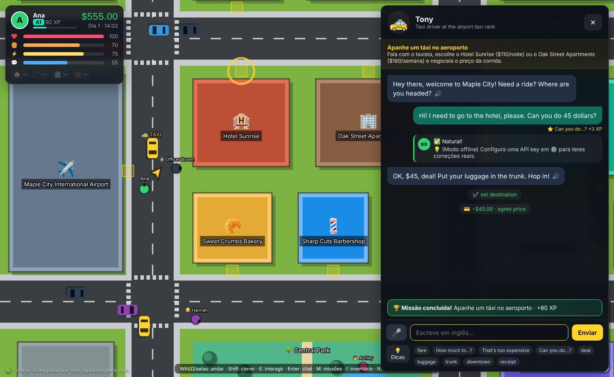
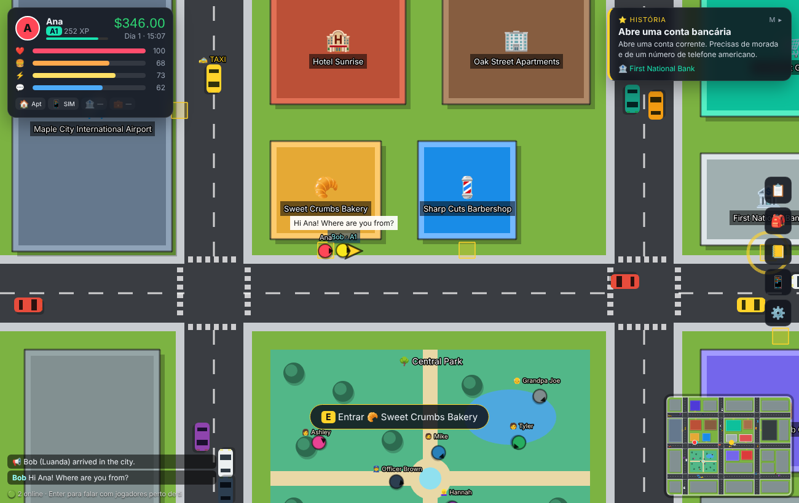

# 🗽 OpenCourse — English City

[English](README.md) · [Português](README.pt.md) · **Français**

[](LICENSE)

[](#-contribuer)
[](https://github.com/Hudson512/Open-Course-ENGLISH-CITY/stargazers)

**Apprenez l'anglais en le vivant : un jeu en monde ouvert (style GTA classique, vu de dessus) où chaque personnage est une IA à qui il faut parler.**

Vous atterrissez à Maple City, aux États-Unis, avec une valise et 600 $. Marchandez avec le chauffeur de taxi, louez une chambre, prenez un téléphone, ouvrez un compte bancaire, réussissez un entretien d'embauche — le tout en anglais, avec un coach invisible qui corrige chaque phrase. Gratuit, open source, et il tourne sur votre machine avec **votre propre clé API** (ou sans aucune clé).



## 💡 Pourquoi ce projet

- **Les applis de langues enseignent des phrases ; la vie demande des conversations.** Ici, vous pratiquez celles qui comptent quand on part vivre à l'étranger : les prix, le loyer, la paperasse, la conversation de tous les jours, les entretiens.
- **L'IA joue le personnage, le jeu garde les règles.** Les PNJ vendent, encaissent, louent et embauchent, mais chaque action est validée par le jeu : le modèle ne peut ni distribuer de l'argent ni sauter des étapes.
- **Ni dépendance à un fournisseur, ni abonnement.** Claude, OpenAI, Gemini, Groq, OpenRouter, un modèle local avec Ollama, ou un mode hors ligne par règles.
- **Assez petit pour être compris en un après-midi.** Environ 3 200 lignes de JavaScript simple et trois dépendances d'exécution.

## 🚀 Essayez-le en une minute

Il vous faut **Node.js 18.17+** ([nodejs.org](https://nodejs.org)). Aucune clé API n'est nécessaire pour un premier essai : sans clé, le jeu tourne en mode hors ligne (**mock**).

```bash
git clone https://github.com/Hudson512/Open-Course-ENGLISH-CITY.git
cd Open-Course-ENGLISH-CITY
npm install
npm start            # compile le jeu et démarre le serveur
```

Ouvrez **http://localhost:8787** dans Chrome ou Edge.

### 🐳 Ou avec Docker (jeu + base de données)

```bash
docker compose up --build
```

Ouvrez **http://localhost:3000**. Trois conteneurs démarrent : `frontend` (nginx qui sert le jeu), `backend` (API Node + multijoueur) et `db` (Postgres). La progression des joueurs est aussi enregistrée dans la base de données, dans le volume `pgdata`, et survit donc aux redémarrages et aux rebuilds ; ⚙️ Paramètres affiche un **code de sauvegarde** pour continuer sur un autre appareil.

- Clés d'IA : mettez-les dans `.env` (lu automatiquement) ou collez-les dans les Paramètres.
- Autre port : `WEB_PORT=8000 docker compose up`.
- Ollama sur votre machine : `LLM_PROVIDER=ollama` et `LLM_BASE_URL=http://host.docker.internal:11434/v1`.
- `docker compose down` arrête tout et conserve les données ; `docker compose down -v` supprime aussi les sauvegardes.

Sans Docker, le jeu garde la progression uniquement dans le navigateur, sauf si vous définissez `DATABASE_URL` vers votre propre Postgres.

## ✨ Ce qui fonctionne déjà (v0.1)

| | |
|---|---|
| ✈️ **Départ** | Vous créez votre personnage (nom, ville d'origine, langue maternelle, profession) et choisissez la destination sur le tableau des départs de l'aéroport. Pour l'instant, seuls les 🇺🇸 États-Unis sont actifs (Royaume-Uni, Canada, Australie, France, Espagne sont marqués « bientôt »). |
| 🚕 **Arrivée** | Vous atterrissez à Maple City et devez **négocier le taxi** avec Tony et choisir entre l'**Hotel Sunrise** (110 $/nuit) et les **Oak Street Apartments** (180 $/semaine). |
| 🌆 **Monde ouvert** | Une ville avec des routes, de la circulation (les voitures freinent… mais attention en traversant !), un parc, 13 lieux où entrer, des piétons avec leur personnalité, un cycle jour/nuit, une mini-carte et une flèche GPS. |
| 🤖 **PNJ pilotés par IA** | 13 personnages fixes (boulangère, coiffeur, serveuse du diner, employée de banque, recruteur…) + 8 piétons. L'IA adapte son langage à votre niveau (A1→C2), reste dans son personnage et **agit dans le monde** (vend, encaisse, loue, embauche) au moyen d'actions validées par le jeu. |
| 🧑‍🏫 **Coach invisible** | Chacune de vos phrases reçoit une note de 0 à 100, une version corrigée/naturelle, des conseils dans votre langue, des mots nouveaux (ajoutés au carnet) et des suggestions de réponse. Traduction automatique aux niveaux A1/A2. |
| 🎤 **Voix** | Les PNJ parlent (synthèse vocale du navigateur) et vous pouvez répondre au micro (Chrome/Edge). |
| ❤️ **Survie** | La faim, l'énergie, le social et la santé baissent avec le temps. Mangez, dormez, discutez. Si vous vous évanouissez, vous payez l'hôpital ; 3 évanouissements = retour au pays (fin de partie). Le loyer est prélevé automatiquement — sans argent, vous êtes expulsé. |
| ⭐ **Histoire** | Taxi → logement → numéro de téléphone → compte bancaire → **entretien d'embauche dans votre domaine** → journées de travail avec salaire. |
| 📅 **Missions quotidiennes** | Générées chaque jour : courses à la boulangerie/à l'épicerie/au café, déjeuner au diner avec pourboire, coupe de cheveux précise, parler aux piétons, parler à de vrais joueurs. |
| 👥 **Multijoueur** | Vous voyez les autres joueurs dans la ville, avec leur niveau CECRL, et parlez à ceux qui sont près de vous (chat de proximité + bulles). En option : l'IA corrige votre anglais dans le chat. |
| 📒 **Carnet** | Vocabulaire collecté automatiquement + cartes mémoire avec répétition espacée simple. |
| 🔌 **N'importe quelle IA** | Anthropic (Claude), OpenAI, Google Gemini, Groq, OpenRouter, **Ollama (100 % local et gratuit)**, tout serveur compatible OpenAI (LM Studio, vLLM…) ou un **mode hors ligne** sans IA pour tester. |



## 🔌 Configurer votre IA (choisissez UNE méthode)

**A) Dans le jeu (le plus simple) :** ⚙️ Paramètres → choisissez le fournisseur → collez votre clé API → *Tester la connexion* → *Enregistrer*.
La clé reste dans le `localStorage` de votre navigateur et n'est envoyée qu'au serveur local du jeu.

**B) Sur le serveur :** copiez `.env.example` vers `.env` et remplissez-le :

```env
LLM_PROVIDER=anthropic
ANTHROPIC_API_KEY=sk-ant-...
```

| Fournisseur | `LLM_PROVIDER` | Variable de la clé | Modèle par défaut* |
|---|---|---|---|
| Anthropic Claude | `anthropic` | `ANTHROPIC_API_KEY` | `claude-haiku-5-5` |
| OpenAI | `openai` | `OPENAI_API_KEY` | `gpt-4o-mini` |
| Google Gemini | `gemini` | `GEMINI_API_KEY` | `gemini-2.5-flash` |
| Groq | `groq` | `GROQ_API_KEY` | `llama-3.3-70b-versatile` |
| OpenRouter | `openrouter` | `OPENROUTER_API_KEY` | `meta-llama/llama-3.3-70b-instruct` |
| Ollama (local) | `ollama` | — | `llama3.1` |
| Autre compatible OpenAI | `custom` | `LLM_API_KEY` + `LLM_BASE_URL` | — |
| Sans IA (hors ligne) | `mock` | — | réponses par règles |

\* Les noms de modèles changent souvent : vous pouvez toujours en choisir un autre dans `LLM_MODEL` ou dans les Paramètres. Pour réduire les coûts, utilisez des modèles « mini/flash/haiku » ; chaque réplique de PNJ est un appel court (~1–2k tokens).

**Gratuit et privé :** installez [Ollama](https://ollama.com), lancez `ollama pull llama3.1` et choisissez `ollama` dans les Paramètres. Les petits modèles respectent moins bien les règles du JSON ; ≥ 8B est recommandé.

### Jouer avec des amis (LAN / même réseau)

Le serveur écoute sur `0.0.0.0:8787`. Vos amis ouvrent `http://<votre-IP>:8787`. Avec `ALLOW_CLIENT_KEYS=true` (par défaut), **chaque joueur utilise sa propre clé**, collée dans ses Paramètres.

> ⚠️ Si vous publiez le serveur sur Internet, définissez `ALLOW_CLIENT_KEYS=false` ou protégez-le : le serveur appelle l'IA au nom de quiconque y joue.

### Commandes

`WASD`/flèches se déplacer · `Shift` courir · `E` interagir · `Enter` chat avec les joueurs · `M` missions · `I` inventaire · `N` carnet · `P` téléphone (taxi) · `Esc` fermer

L'interface du jeu est disponible en portugais et en anglais (pas encore en français) ; le français peut être choisi comme langue maternelle pour les conseils du coach. Les PNJ parlent toujours anglais et s'adaptent à votre niveau CECRL.

## 🧱 Comment ça marche

```
client/            Vite + Phaser 3 (monde) + DOM (HUD, dialogues, menus)
  src/scenes/      WorldScene : carte, physique, piétons, circulation, caméras, GPS
  src/ui/          hud, dialog (conversation avec l'IA), panels, screens
  src/state.js     état, survie, application des actions, XP, vocabulaire, sauvegarde (localStorage)
server/            Node + Express + ws
  index.js         API : /api/npc/turn, /api/chat/check, /api/llm/test, /api/config, /api/save/:id
  db.js            sauvegardes des joueurs dans Postgres (facultatif, via DATABASE_URL)
  prompts.js       construit le prompt du PNJ (personnage, scène, niveau, règles, format)
  llm.js           client multi-fournisseur + analyse robuste du JSON
  mock.js          PNJ hors ligne par règles
  multiplayer.js   présence, positions, chat de proximité
shared/            utilisé par le client ET le serveur
  world.js         carte (routes, bâtiments, portes)
  npcs.js          personnages
  missions.js      missions, contrat d'actions, validation, générateur quotidien
  data.js          catalogues/prix, niveaux CECRL, professions
```

**Comment un PNJ « agit » :** le modèle renvoie toujours du JSON :

```json
{ "reply": "Two croissants, coming right up!", "actions": [{"type":"sell","item":"croissant","qty":2,"unitPrice":3.5}],
  "feedback": {"score": 72, "corrected": "Can I have two croissants, please?", "tips": ["..."], "newWords": [...]},
  "suggestions": ["To go, please."], "translation": "..." }
```

Le jeu **valide** chaque action (`shared/missions.js → validateAction`) : uniquement les actions autorisées dans la scène, prix conformes au catalogue (±30 %), négociation du taxi entre 35 $ et 100 $, compte bancaire seulement avec une adresse et un téléphone, embauche seulement au niveau A2 + conditions requises. Les paiements refusés reviennent au PNJ sous la forme `[GAME: Payment DECLINED…]` pour qu'il réagisse.

## 🤝 Contribuer

Le projet est jeune et il y a de la place pour tous les types de contribution — **pas besoin d'être développeur de jeux, ni même développeur.** Les enseignants, les traducteurs, les auteurs et les artistes sont aussi bienvenus que celles et ceux qui écrivent du code.

### Bonnes premières contributions

| Si vous aimez… | Vous pourriez… | Où |
|---|---|---|
| 🌍 Les langues | Traduire l'interface en français, en espagnol ou dans votre langue | `client/src/i18n.js` |
| ✍️ L'écriture | Créer un nouveau personnage, avec sa personnalité et sa façon de parler | `shared/npcs.js` |
| 🎯 L'enseignement | Concevoir une mission autour d'une situation réelle (pharmacie, bureau de poste, appel au propriétaire…) | `TEMPLATES` dans `shared/missions.js` |
| 🏙️ La création de mondes | Ajouter un lieu à la ville, avec sa boutique et ses prix | `shared/world.js`, `shared/data.js` |
| 🎨 Le pixel art | Dessiner des sprites et des tuiles CC0 pour remplacer les formes colorées | `client/src/scenes/WorldScene.js` |
| 🧠 Les sciences de l'apprentissage | Remplacer les cartes mémoire simples par une vraie répétition espacée (SM-2) | `client/src/ui/panels.js` |
| 🤖 Les prompts | Rendre les PNJ plus naturels ou plus fiables avec de petits modèles locaux | `server/prompts.js`, `server/mock.js` |
| 📱 Le front-end | Ajouter un joystick virtuel pour mobile | `client/src/` |

Ajouter du contenu, c'est surtout des données, pas du travail sur le moteur :

- **Nouveau lieu :** ajoutez-le dans `shared/world.js` (`LOCATIONS`), le PNJ dans `shared/npcs.js`, la correspondance dans `LOCATION_NPC` et, s'il vend des choses, le catalogue dans `shared/data.js`.
- **Nouvelle mission :** créez un modèle dans `TEMPLATES` (`shared/missions.js`) avec `objective` (instructions pour le PNJ), `goal` (texte pour le joueur en pt/en), `actions`, `vocab`, `reward` et `isComplete`. Ajoutez-le à `generateDaily` ou à `STORY`.
- **Nouveau pays/nouvelle langue :** les textes des PNJ et les prompts sont séparés par destination cible — la prochaine étape est de paramétrer `CITY`, les catalogues et les personnages par `destination`.

### Flux de développement

```bash
npm run dev    # serveur avec rechargement + Vite sur http://localhost:5173
npm test       # tests (analyse, validation, prompts, mock)
```

1. Forkez le dépôt et créez une branche pour votre modification.
2. Lancez `npm run dev`. Le mode mock permet de travailler sans dépenser de crédits d'API.
3. Lancez `npm test` avant d'ouvrir la pull request.
4. Ouvrez une PR et décrivez ce qui a changé. Une capture d'écran aide pour tout ce qui est visuel.

Vous ne savez pas par où commencer, ou vous avez une idée ? [Ouvrez une issue](https://github.com/Hudson512/Open-Course-ENGLISH-CITY/issues) — les questions et les suggestions sont les bienvenues, en anglais, en portugais ou en français.

### 🗺️ Feuille de route

- [ ] Intérieurs des bâtiments et sprites/tuiles en pixel art (CC0)
- [ ] Missions multijoueur coopératives (p. ex. un joueur demande son chemin, l'autre explique) et « jobs » partagés
- [ ] Test de placement initial avec l'IA
- [ ] Plus de destinations : 🇬🇧 Londres, 🇨🇦 Toronto, 🇦🇺 Sydney, et d'autres langues (🇫🇷 🇪🇸)
- [ ] Transports en commun, voiture personnelle, factures (électricité, téléphone), achats en ligne
- [ ] Vraie répétition espacée (SM-2) et rapports de progression
- [x] Docker et sauvegardes côté serveur (Postgres)
- [ ] Comptes facultatifs et monde partagé persistant
- [ ] Mode mobile (joystick virtuel)

## ⭐ Soutenir le projet

Si vous pensez qu'apprendre une langue devrait ressembler à vivre quelque part plutôt qu'à remplir des exercices, mettez une étoile au dépôt et partagez-le avec quelqu'un qui apprend l'anglais. Cela aide d'autres contributeurs à trouver le projet.

## 📄 Licence

[MIT](LICENSE) — utilisez-le, forkez-le, enseignez avec.
