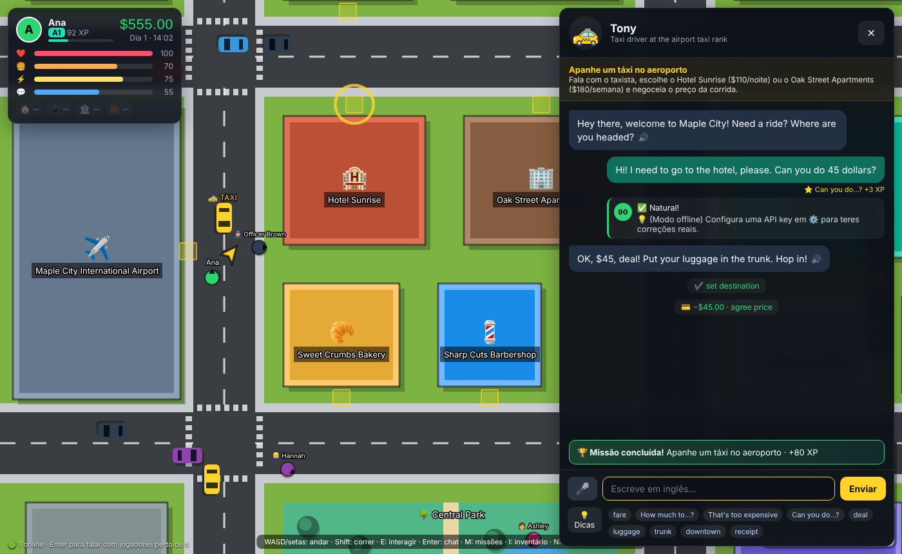
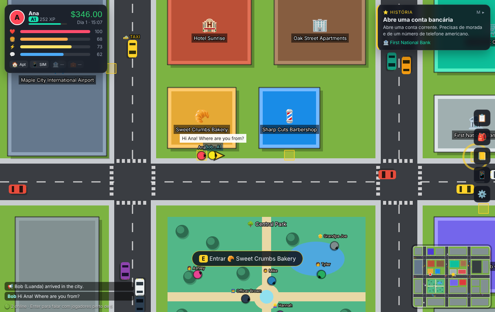

# 🗽 OpenCourse — English City

**English** · [Português](README.pt.md) · [Français](README.fr.md)

[](LICENSE)

[](#-contributing)
[](https://github.com/Hudson512/Open-Course-ENGLISH-CITY/stargazers)

**Learn English by actually living it: an open-world game (classic top-down GTA style) where every character is an AI you have to talk to.**

You land in a city where everyone speaks English — **Maple City** 🇺🇸 with $600 or **London** 🇬🇧 with £500 — carrying a suitcase. Haggle with the taxi driver, rent a room, get a phone, open a bank account, pass a job interview — all in English, with a hidden coach correcting every sentence. Free, open source, and it runs on your own machine with **your own API key** (or with no key at all).



## 💡 Why this project

- **Language apps teach sentences; life needs conversations.** Here you practise the ones that matter when you move abroad: prices, rent, paperwork, small talk, interviews.
- **The AI plays the character, the game keeps the rules.** NPCs can sell, charge, rent and hire, but every action is validated by the game, so the model cannot hand out money or skip steps.
- **No lock-in, no subscription.** Claude, OpenAI, Gemini, Groq, OpenRouter, a local Ollama model, or an offline rule-based mode.
- **Cities are text files, not code.** A city is a folder of YAML: map, places, characters, prices, missions. [Add a pharmacy in ten minutes](docs/creating-a-city.md), or write your own city.
- **Small enough to understand in an afternoon.** About 3,500 lines of plain JavaScript and five runtime dependencies.

## 🚀 Try it in one minute

You need **Node.js 18.17+** ([nodejs.org](https://nodejs.org)). No API key is required for a first look: without one, the game runs in offline **mock** mode.

```bash
git clone https://github.com/Hudson512/Open-Course-ENGLISH-CITY.git
cd Open-Course-ENGLISH-CITY
npm install
npm start            # builds the game and starts the server
```

Open **http://localhost:8787** in Chrome or Edge.

### 🐳 Or with Docker (game + database)

```bash
docker compose up --build
```

Open **http://localhost:3000**. Three containers start: `frontend` (nginx serving the game), `backend` (Node API + multiplayer) and `db` (Postgres). Player progress is also saved in the database, in the `pgdata` volume, so it survives restarts and rebuilds; ⚙️ Settings shows a **save code** to continue on another device.

- AI keys: put them in `.env` (it is read automatically) or paste them in Settings.
- Another port: `WEB_PORT=8000 docker compose up`.
- Ollama on your machine: `LLM_PROVIDER=ollama` and `LLM_BASE_URL=http://host.docker.internal:11434/v1`.
- `docker compose down` stops everything and keeps the data; `docker compose down -v` also deletes the saves.
- Shortcuts: `make up`, `make stop`, `make restart`, `make logs`, `make db-backup`… run `make` to see them all.

Without Docker the game keeps progress in the browser only, unless you set `DATABASE_URL` to a Postgres of your own.

## ✨ What already works (v0.1)

| | |
|---|---|
| ✈️ **Departure** | Create your character (name, home city, native language, profession) and pick a flight on the airport departures board: 🇺🇸 **Maple City** (US English) or 🇬🇧 **London** (British English). Toronto, Sydney, Paris and Madrid are marked "coming soon". |
| 🚕 **Arrival** | Negotiate the taxi and choose where to live: in Maple City, **Hotel Sunrise** ($110/night) or **Oak Street Apartments** ($180/week); in London, a black cab to **Wanderers Hostel** (£35/night) or the **Albion Road Flatshare** (£160/week). |
| 🌆 **Open world** | Each city has its own map: roads, traffic (cars brake… but be careful crossing!), a park, 13–14 places you can enter, pedestrians with personality, a day/night cycle, a minimap and a GPS arrow. |
| 🤖 **AI NPCs** | In each city, a character in every place (baker, barber, bank teller, recruiter…) + 8 pedestrians, speaking the local English: *line* and *apartment* in Maple City, *queue* and *flat* in London. The AI adapts its language to your level (A1→C2), stays in character and **acts in the world** (sells, charges, rents, hires) through actions validated by the game. |
| 🧑‍🏫 **Invisible coach** | Every sentence you write gets a 0–100 score, a corrected/natural version, tips in your language, new words (saved to your notebook) and reply suggestions. Automatic translation at levels A1/A2. |
| 🏫 **English school** | Every city has a school with a classroom: the teacher writes the phrases on the blackboard, you hear them, say them into the microphone and practise with short exercises, before the mission that needs them. A1 lessons today (first words, taxi, a place to stay, phone); after each mission a report shows what to say better, and your phone reminds you of the next lesson and of the phrases to review (spaced repetition). Lessons are YAML in [`courses/english/`](courses/english/), so teachers can write more. |
| 🎤 **Voice** | NPCs speak and you answer with your microphone: hold 🎤 to talk and release to send, like a voice message, so you can pause to think. With a [Deepgram](https://deepgram.com) key the characters get natural voices with the accent of their city, your speech is understood in any browser, and an optional **hands-free** mode notices when you have finished speaking (it waits longer for beginners). Without a key the browser's own speech tools are used (Chrome/Edge). |
| ❤️ **Survival** | Hunger, energy, social and health drop over time. Eat, sleep, talk. If you faint you pay the hospital; 3 faints = you go back home (game over). Rent is charged automatically — with no money, you get evicted. |
| ⭐ **Story** | Taxi → housing → phone number → bank account → **job interview in your field** → daily work shifts with a salary. London adds getting an Oyster card at the Tube station. |
| 📅 **Daily missions** | Generated per day: shopping at the bakery, the supermarket or the café, lunch at the diner or the pub, a specific haircut, talking to pedestrians, talking to real players. |
| 👥 **Multiplayer** | See other players in the city, with their CEFR level, and talk to whoever is nearby (proximity chat + speech bubbles). Optional: the AI corrects your English in chat. |
| 📒 **Notebook** | Vocabulary collected automatically + flashcards with simple spaced repetition. |
| 🔌 **Any AI** | Anthropic (Claude), OpenAI, Google Gemini, Groq, OpenRouter, **Ollama (100% local and free)**, any OpenAI-compatible server (LM Studio, vLLM…) or an **offline mode** with no AI for testing. |
| 🧩 **City packs** | Every city is a folder of YAML files that the game checks and compiles when it starts. New places, characters, missions and whole cities need no programming: see the [guide](docs/creating-a-city.md). |
| 🏙️ **First person and city viewer** | Press **V** in the game to walk the streets in first person, Wolfenstein-style (ray casting), with the people, cars, doors and missions of the city; press it again for a 3D view with the camera behind you (Three.js), and once more for the view from above. The city viewer shows any city as a map, as a 3D city you can turn around (Three.js), or walk its streets in first person, Wolfenstein-style (ray casting): 🗺️ on the title screen, or `viewer.html?city=london`. Handy while creating a city. |



## 🔌 Set up your AI (pick ONE way)

**A) In the game (easiest):** ⚙️ Settings → pick the provider → paste your API key → *Test connection* → *Save*.
The key stays in your browser's `localStorage` and is only sent to the game's local server.

**B) On the server:** copy `.env.example` to `.env` and fill it in:

```env
LLM_PROVIDER=anthropic
ANTHROPIC_API_KEY=sk-ant-...
```

| Provider | `LLM_PROVIDER` | Key variable | Default model* |
|---|---|---|---|
| Anthropic Claude | `anthropic` | `ANTHROPIC_API_KEY` | `claude-haiku-5-5` |
| OpenAI | `openai` | `OPENAI_API_KEY` | `gpt-4o-mini` |
| Google Gemini | `gemini` | `GEMINI_API_KEY` | `gemini-2.5-flash` |
| Groq | `groq` | `GROQ_API_KEY` | `llama-3.3-70b-versatile` |
| OpenRouter | `openrouter` | `OPENROUTER_API_KEY` | `meta-llama/llama-3.3-70b-instruct` |
| Ollama (local) | `ollama` | — | `llama3.1` |
| Other OpenAI-compatible | `custom` | `LLM_API_KEY` + `LLM_BASE_URL` | — |
| No AI (offline) | `mock` | — | rule-based replies |

\* Model names change often: you can always choose another one in `LLM_MODEL` or in Settings. For low costs use "mini/flash/haiku" models; each NPC line is one short call (~1–2k tokens).

**Free and private:** install [Ollama](https://ollama.com), run `ollama pull llama3.1` and choose `ollama` in Settings. Small models follow the JSON rules less reliably; ≥ 8B is recommended.

**Natural voices and better listening (optional):** add `DEEPGRAM_API_KEY=...` to `.env`. The characters then speak with [Deepgram Aura-2](https://developers.deepgram.com/docs/tts-models) voices — American in Maple City, British in London — and your microphone is transcribed by [Deepgram Flux](https://developers.deepgram.com/docs/flux/quickstart), which also enables hands-free conversation (⚙️ Settings). Audio goes through the game server, so the key never reaches the browser. Leave it out and the browser's own voices and speech recognition are used.

### Play with friends (LAN / same network)

The server listens on `0.0.0.0:8787`. Friends open `http://<your-IP>:8787`. With `ALLOW_CLIENT_KEYS=true` (the default) **each player uses their own key**, pasted in their own Settings.

> ⚠️ If you publish the server on the internet, set `ALLOW_CLIENT_KEYS=false` or protect it: the server makes AI calls on behalf of whoever plays there.

### Controls

`WASD`/arrows move · `Shift` run · `E` interact · `V` change view: from above, first person, 3D (or 🎥; W/S walk, A/D or the mouse turn) · `Enter` chat with players · `M` missions · `I` inventory · `N` notebook · `P` phone (taxi) · `Esc` close

The interface is available in Portuguese and English; NPCs always speak English and adapt to your CEFR level.

## 🧱 How it works

```
client/            Vite + Phaser 3 (world) + DOM (HUD, dialogues, menus)
  src/scenes/      WorldScene: map, physics, pedestrians, traffic, cameras, GPS
  src/ui/          hud, dialog (AI conversation), panels, screens
  src/state.js     state, survival, applying actions, XP, vocabulary, save (localStorage)
  src/flux.js      microphone → server → Deepgram Flux; speech.js: voices and the browser fallback
  src/viewer/      city viewer: 3D (Three.js) and first person (ray casting)
server/            Node + Express + ws
  index.js         API: /api/packs, /api/npc/turn, /api/chat/check, /api/llm/test, /api/config, /api/save/:id
  packs.js         compiles the cities in packs/ when the server starts
  db.js            player saves in Postgres (optional, via DATABASE_URL)
  prompts.js       builds the NPC prompt (character, scene, level, rules, format)
  llm.js           multi-provider client + robust JSON parsing
  mock.js          rule-based offline NPC
  multiplayer.js   presence, positions, proximity chat
  tts.js           character voices with Deepgram Aura-2 (optional)
  stt.js           relays the microphone to Deepgram Flux speech-to-text (optional)
shared/            used by client AND server
  engine.js        the rules: missions, validating actions, effects, daily generator
  pack.js          reading a city: text templates and conditions
  scene.js         a city as a 3D scene, read by every view
  data.js          the same in every city: CEFR levels, professions
packs/             the cities, one folder of YAML each
  maple-city/      city, map, places, people, actions, missions
  london/
tools/pack/        the checker/compiler for city packs (npm run pack)
```

**How an NPC "acts":** the model always returns JSON:

```json
{ "reply": "Two croissants, coming right up!", "actions": [{"type":"sell","item":"croissant","qty":2,"unitPrice":3.5}],
  "feedback": {"score": 72, "corrected": "Can I have two croissants, please?", "tips": ["..."], "newWords": [...]},
  "suggestions": ["To go, please."], "translation": "..." }
```

The game **validates** every action (`shared/engine.js → validateAction`) against the city's `actions.yaml`: only actions allowed in the scene, prices within the place's list (±30%), taxi haggling within the city's limits ($35–$100 in Maple City), a bank account only with an address and a phone, hiring only at level A2 + requirements. Declined payments go back to the NPC as `[GAME: Payment DECLINED…]` so it can react.

## 🤝 Contributing

This project is young and there is room for every kind of contribution — **you do not need to be a game developer, or even a programmer.** Teachers, translators, writers and artists are as welcome as coders.

### Good first contributions

| If you like… | You could… | Where |
|---|---|---|
| 🌍 Languages | Translate the interface into French, Spanish or your own language | `client/src/i18n.js` |
| ✍️ Writing | Create a new character with a personality and a way of speaking | `packs/<city>/places.yaml`, `people.yaml` |
| 🎯 Teaching | Design a mission around a real-life situation (pharmacy, post office, landlord call…) | `packs/<city>/missions.yaml` |
| 🏙️ World building | Add a place to a city, or write a whole new city (Toronto? Sydney? Lagos?) | `packs/` — [guide](docs/creating-a-city.md) |
| 🎨 Pixel art | Draw CC0 sprites and tiles to replace the coloured shapes | `client/src/scenes/WorldScene.js` |
| 🧠 Learning science | Replace the simple flashcards with real spaced repetition (SM-2) | `client/src/ui/panels.js` |
| 🤖 Prompting | Make NPCs more natural or more reliable with small local models | `server/prompts.js`, `server/mock.js` |
| 📱 Front-end | Add a virtual joystick for mobile | `client/src/` |

Adding content is writing text files, not engine work. The **[guide to creating places, missions and cities](docs/creating-a-city.md)** walks through it step by step:

- **New place:** one block in `packs/<city>/places.yaml` — the building, who works there, the price list.
- **New mission:** one block in `packs/<city>/missions.yaml` — what the player must do (`goal`), what the AI knows (`brief`), what it may do (`allow`) and when it is done (`complete`).
- **New city:** copy a folder in `packs/`, change the map, the places and the story. `npm run pack` tells you in plain words what is wrong. Every field is in the [specification](docs/city-pack-spec.md).

### Development workflow

```bash
npm run dev    # server with reload + Vite at http://localhost:5173
npm test       # tests (parsing, validation, prompts, mock)
npm run pack   # checks the city packs, says what to fix and draws each map (packs/<city>/preview.svg)
```

1. Fork the repository and create a branch for your change.
2. Run `npm run dev`. Mock mode lets you work without spending any API credits.
3. Run `npm test` (and `npm run pack` if you touched a city) before opening the pull request.
4. Open a PR and describe what changed. A screenshot helps for anything visual.

Every pull request is checked automatically (tests, city packs, map pictures, build) by [GitHub Actions](.github/workflows/check.yml).

Not sure where to start, or have an idea? [Open an issue](https://github.com/Hudson512/Open-Course-ENGLISH-CITY/issues) — questions and suggestions are welcome, in English, Portuguese or French.

### 🗺️ Roadmap

- [ ] Building interiors and pixel-art sprites/tiles (CC0)
- [ ] Cooperative multiplayer missions (e.g. one player asks for directions, the other explains) and shared "jobs"
- [ ] Initial placement test with the AI
- [ ] More cities: 🇨🇦 Toronto, 🇦🇺 Sydney… and other languages (🇫🇷 🇪🇸)
- [ ] Public transport, your own car, bills (electricity, phone), online shopping
- [ ] Proper spaced repetition (SM-2) and progress reports
- [x] Docker setup and server-side saves (Postgres)
- [x] City packs: cities written in YAML, with 🇺🇸 Maple City and 🇬🇧 London
- [ ] Optional accounts and a persistent shared world
- [ ] Mobile mode (virtual joystick)

## ⭐ Support the project

If you think learning a language should feel like living somewhere and not like filling in exercises, star the repository and share it with someone who is learning English. It helps other contributors find the project.

## 📄 License

[MIT](LICENSE) — use it, fork it, teach with it.
