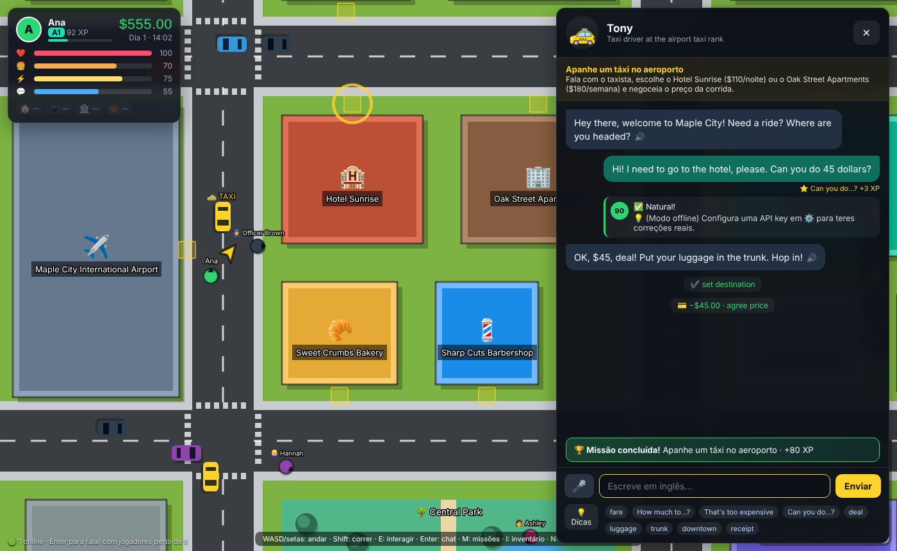
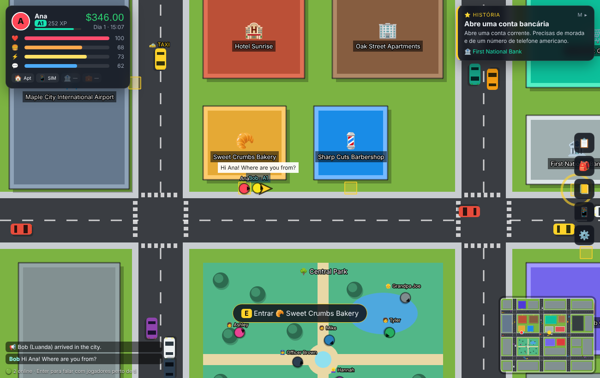

# 🗽 OpenCourse — English City

[English](README.md) · **Português** · [Français](README.fr.md)

[](LICENSE)

[](#-contribuir)
[](https://github.com/Hudson512/Open-Course-ENGLISH-CITY/stargazers)

**Aprende inglês a vivê-lo: um jogo de mundo aberto (estilo GTA clássico, visto de cima) em que cada personagem é uma IA com quem tens de falar.**

Aterras numa cidade onde toda a gente fala inglês — **Maple City** 🇺🇸 com $600 ou **Londres** 🇬🇧 com £500 — só com uma mala. Regateias com o taxista, arrendas um quarto, arranjas um telefone, abres uma conta bancária, passas numa entrevista de emprego — tudo em inglês, com um coach invisível a corrigir cada frase. Grátis, open source, e corre na tua máquina com a **tua própria API key** (ou sem chave nenhuma).



## 💡 Porquê este projecto

- **As apps de línguas ensinam frases; a vida pede conversas.** Aqui praticas as que contam quando te mudas para fora: preços, renda, papelada, conversa de circunstância, entrevistas.
- **A IA faz de personagem, o jogo guarda as regras.** Os NPCs vendem, cobram, arrendam e contratam, mas cada acção é validada pelo jogo, por isso o modelo não pode oferecer dinheiro nem saltar etapas.
- **Sem dependência de fornecedor, sem subscrição.** Claude, OpenAI, Gemini, Groq, OpenRouter, um modelo local no Ollama, ou um modo offline por regras.
- **As cidades são ficheiros de texto, não código.** Uma cidade é uma pasta de YAML: mapa, locais, personagens, preços, missões. [Acrescenta uma farmácia em dez minutos](docs/creating-a-city.pt.md), ou escreve a tua própria cidade.
- **Pequeno o suficiente para se perceber numa tarde.** Cerca de 3 500 linhas de JavaScript simples e cinco dependências de produção.

## 🚀 Experimenta num minuto

Precisas de **Node.js 18.17+** ([nodejs.org](https://nodejs.org)). Não é preciso API key para experimentar: sem chave, o jogo corre em modo offline (**mock**).

```bash
git clone https://github.com/Hudson512/Open-Course-ENGLISH-CITY.git
cd Open-Course-ENGLISH-CITY
npm install
npm start            # compila o jogo e abre o servidor
```

Abre **http://localhost:8787** no Chrome ou Edge.

### 🐳 Ou com Docker (jogo + base de dados)

```bash
docker compose up --build
```

Abre **http://localhost:3000**. Arrancam três contentores: `frontend` (nginx a servir o jogo), `backend` (API Node + multiplayer) e `db` (Postgres). O progresso dos jogadores fica também guardado na base de dados, no volume `pgdata`, por isso sobrevive a reinícios e rebuilds; em ⚙️ Definições aparece um **código do save** para continuar noutro dispositivo.

- Chaves de IA: coloca-as no `.env` (é lido automaticamente) ou cola-as nas Definições.
- Outra porta: `WEB_PORT=8000 docker compose up`.
- Ollama na tua máquina: `LLM_PROVIDER=ollama` e `LLM_BASE_URL=http://host.docker.internal:11434/v1`.
- `docker compose down` pára tudo e mantém os dados; `docker compose down -v` apaga também os saves.
- Atalhos: `make up`, `make stop`, `make restart`, `make logs`, `make db-backup`… corre `make` para ver todos.

Sem Docker o jogo guarda o progresso apenas no browser, a não ser que definas `DATABASE_URL` com um Postgres teu.

## ✨ O que já funciona (v0.1)

| | |
|---|---|
| ✈️ **Partida** | Crias a personagem (nome, cidade natal, língua materna, profissão) e escolhes um voo no painel de partidas do aeroporto: 🇺🇸 **Maple City** (inglês americano) ou 🇬🇧 **Londres** (inglês britânico). Toronto, Sydney, Paris e Madrid estão marcados "em breve". |
| 🚕 **Chegada** | Negoceias o táxi e escolhes onde morar: na Maple City, o **Hotel Sunrise** ($110/noite) ou os **Oak Street Apartments** ($180/semana); em Londres, um táxi preto até ao **Wanderers Hostel** (£35/noite) ou ao **Albion Road Flatshare** (£160/semana). |
| 🌆 **Mundo aberto** | Cada cidade tem o seu mapa: estradas, trânsito (os carros travam… mas cuidado ao atravessar!), um parque, 13–14 locais onde podes entrar, peões com personalidade, ciclo dia/noite, minimapa e seta de GPS. |
| 🤖 **NPCs de IA** | Em cada cidade, uma personagem em cada local (padeira, barbeiro, bancário, recrutadora…) + 8 peões, a falar o inglês de lá: *line* e *apartment* na Maple City, *queue* e *flat* em Londres. A IA adapta a linguagem ao teu nível (A1→C2), mantém a personagem e **age no mundo** (vende, cobra, aluga, contrata) através de ações validadas pelo jogo. |
| 🧑‍🏫 **Coach invisível** | Cada frase tua recebe nota 0–100, versão corrigida/natural, dicas na tua língua, palavras novas (vão para o caderno) e sugestões de resposta. Tradução automática nos níveis A1/A2. |
| 🎤 **Voz** | Os NPCs falam e tu respondes ao microfone: mantém 🎤 premido para falar e solta para enviar, como uma mensagem de voz, para poderes parar para pensar. Com uma chave da [Deepgram](https://deepgram.com) as personagens ganham vozes naturais com o sotaque da cidade, a tua fala é percebida em qualquer browser, e há um modo **mãos-livres** opcional que percebe quando acabaste de falar (espera mais pelos principiantes). Sem chave usam-se as ferramentas de voz do browser (Chrome/Edge). |
| ❤️ **Sobrevivência** | Fome, energia, social e saúde descem com o tempo. Come, dorme, conversa. Se desmaias pagas o hospital; 3 desmaios = voltas para casa (fim de jogo). Renda cobrada automaticamente — sem dinheiro, és despejado. |
| ⭐ **História** | Táxi → alojamento → número de telefone → conta bancária → **entrevista de emprego na tua área** → turnos de trabalho diários com salário. Londres acrescenta arranjar um cartão Oyster na estação de metro. |
| 📅 **Missões diárias** | Geradas por dia: compras na padaria, no supermercado ou no café, almoço no diner ou no pub, um corte de cabelo específico, falar com peões, falar com jogadores reais. |
| 👥 **Multiplayer** | Vês os outros jogadores na cidade, com nível CEFR, e falas com quem está perto (chat de proximidade + balões). Opcional: a IA corrige o teu inglês no chat. |
| 📒 **Caderno** | Vocabulário recolhido automaticamente + flashcards com repetição espaçada simples. |
| 🔌 **Qualquer IA** | Anthropic (Claude), OpenAI, Google Gemini, Groq, OpenRouter, **Ollama (100% local e grátis)**, qualquer servidor compatível com OpenAI (LM Studio, vLLM…) ou **modo offline** sem IA para testar. |
| 🧩 **City packs** | Cada cidade é uma pasta de ficheiros YAML que o jogo verifica e compila ao arrancar. Novos locais, personagens, missões e cidades inteiras não precisam de programação: vê o [guia](docs/creating-a-city.pt.md). |



## 🔌 Configurar a tua IA (escolhe UMA forma)

**A) No jogo (mais fácil):** ⚙️ Definições → escolhe o provedor → cola a API key → *Testar ligação* → *Guardar*.
A chave fica no `localStorage` do teu browser e só é enviada para o servidor local do jogo.

**B) No servidor:** copia `.env.example` para `.env` e preenche:

```env
LLM_PROVIDER=anthropic
ANTHROPIC_API_KEY=sk-ant-...
```

| Provedor | `LLM_PROVIDER` | Variável da chave | Modelo por omissão* |
|---|---|---|---|
| Anthropic Claude | `anthropic` | `ANTHROPIC_API_KEY` | `claude-haiku-5-5` |
| OpenAI | `openai` | `OPENAI_API_KEY` | `gpt-4o-mini` |
| Google Gemini | `gemini` | `GEMINI_API_KEY` | `gemini-2.5-flash` |
| Groq | `groq` | `GROQ_API_KEY` | `llama-3.3-70b-versatile` |
| OpenRouter | `openrouter` | `OPENROUTER_API_KEY` | `meta-llama/llama-3.3-70b-instruct` |
| Ollama (local) | `ollama` | — | `llama3.1` |
| Outro compatível OpenAI | `custom` | `LLM_API_KEY` + `LLM_BASE_URL` | — |
| Sem IA (offline) | `mock` | — | respostas por regras |

\* Os nomes de modelos mudam com frequência: podes sempre escolher outro em `LLM_MODEL` ou nas Definições. Para custos baixos usa modelos "mini/flash/haiku"; cada fala de NPC é uma chamada curta (~1–2k tokens).

**Grátis e privado:** instala o [Ollama](https://ollama.com), corre `ollama pull llama3.1` e escolhe `ollama` nas Definições. Modelos pequenos seguem pior as regras do JSON; recomenda-se ≥ 8B.

**Vozes naturais e melhor escuta (opcional):** acrescenta `DEEPGRAM_API_KEY=...` ao `.env`. As personagens passam a falar com vozes [Deepgram Aura-2](https://developers.deepgram.com/docs/tts-models) — americanas na Maple City, britânicas em Londres — e o teu microfone é transcrito pelo [Deepgram Flux](https://developers.deepgram.com/docs/flux/quickstart), que também permite a conversa mãos-livres (⚙️ Definições). O áudio passa pelo servidor do jogo, por isso a chave nunca chega ao browser. Sem ela, usam-se as vozes e o reconhecimento de voz do próprio browser.

### Jogar com amigos (LAN / mesma rede)

O servidor escuta em `0.0.0.0:8787`. Os amigos abrem `http://<o-teu-IP>:8787`. Com `ALLOW_CLIENT_KEYS=true` (padrão) **cada jogador usa a sua própria chave**, colada nas Definições dele.

> ⚠️ Se publicares o servidor na internet, define `ALLOW_CLIENT_KEYS=false` ou protege-o: o servidor faz chamadas à IA em nome de quem lá jogar.

### Controlos

`WASD`/setas andar · `Shift` correr · `E` interagir · `Enter` chat com jogadores · `M` missões · `I` inventário · `N` caderno · `P` telemóvel (táxi) · `Esc` fechar

A interface está disponível em português e inglês; os NPCs falam sempre inglês e adaptam-se ao teu nível CEFR.

## 🧱 Como funciona

```
client/            Vite + Phaser 3 (mundo) + DOM (HUD, diálogos, menus)
  src/scenes/      WorldScene: mapa, física, peões, trânsito, câmaras, GPS
  src/ui/          hud, dialog (conversa com IA), panels, screens
  src/state.js     estado, sobrevivência, aplicar ações, XP, vocabulário, save (localStorage)
  src/flux.js      microfone → servidor → Deepgram Flux; speech.js: vozes e a alternativa do browser
server/            Node + Express + ws
  index.js         API: /api/packs, /api/npc/turn, /api/chat/check, /api/llm/test, /api/config, /api/save/:id
  packs.js         compila as cidades de packs/ quando o servidor arranca
  db.js            saves dos jogadores em Postgres (opcional, via DATABASE_URL)
  prompts.js       constrói o prompt do NPC (personagem, cena, nível, regras, formato)
  llm.js           cliente multi-provedor + parsing robusto de JSON
  mock.js          NPC offline por regras
  multiplayer.js   presença, posições, chat de proximidade
  tts.js           vozes das personagens com Deepgram Aura-2 (opcional)
  stt.js           encaminha o microfone para o Deepgram Flux, speech-to-text (opcional)
shared/            usado por cliente E servidor
  engine.js        as regras: missões, validação de ações, efeitos, gerador diário
  pack.js          ler uma cidade: modelos de texto e condições
  data.js          igual em todas as cidades: níveis CEFR, profissões
packs/             as cidades, uma pasta de YAML cada
  maple-city/      cidade, mapa, locais, pessoas, ações, missões
  london/
tools/pack/        o verificador/compilador de city packs (npm run pack)
```

**Como um NPC "age":** o modelo devolve sempre JSON:

```json
{ "reply": "Two croissants, coming right up!", "actions": [{"type":"sell","item":"croissant","qty":2,"unitPrice":3.5}],
  "feedback": {"score": 72, "corrected": "Can I have two croissants, please?", "tips": ["..."], "newWords": [...]},
  "suggestions": ["To go, please."], "translation": "..." }
```

O jogo **valida** cada ação (`shared/engine.js → validateAction`) contra o `actions.yaml` da cidade: só ações permitidas na cena, preços dentro da tabela do local (±30%), regateio do táxi dentro dos limites da cidade ($35–$100 na Maple City), conta bancária só com morada e telefone, contratação só com nível A2 + requisitos. Pagamentos recusados voltam ao NPC como `[GAME: Payment DECLINED…]` para ele reagir.

## 🤝 Contribuir

O projecto é jovem e há espaço para todo o tipo de contribuição — **não precisas de ser programador de jogos, nem sequer programador.** Professores, tradutores, escritores e artistas são tão bem-vindos como quem escreve código.

### Boas primeiras contribuições

| Se gostas de… | Podes… | Onde |
|---|---|---|
| 🌍 Línguas | Traduzir a interface para francês, espanhol ou a tua língua | `client/src/i18n.js` |
| ✍️ Escrita | Criar uma personagem nova, com personalidade e maneira de falar | `packs/<cidade>/places.yaml`, `people.yaml` |
| 🎯 Ensino | Desenhar uma missão à volta de uma situação real (farmácia, correios, chamada do senhorio…) | `packs/<cidade>/missions.yaml` |
| 🏙️ Criar mundos | Acrescentar um local a uma cidade, ou escrever uma cidade nova (Toronto? Sydney? Lagos?) | `packs/` — [guia](docs/creating-a-city.pt.md) |
| 🎨 Pixel art | Desenhar sprites e tiles CC0 para substituir as formas coloridas | `client/src/scenes/WorldScene.js` |
| 🧠 Ciência da aprendizagem | Trocar os flashcards simples por repetição espaçada a sério (SM-2) | `client/src/ui/panels.js` |
| 🤖 Prompts | Tornar os NPCs mais naturais ou mais fiáveis com modelos locais pequenos | `server/prompts.js`, `server/mock.js` |
| 📱 Front-end | Acrescentar um joystick virtual para telemóvel | `client/src/` |

Acrescentar conteúdo é escrever ficheiros de texto, não trabalho de motor. O **[guia para criar locais, missões e cidades](docs/creating-a-city.pt.md)** explica passo a passo:

- **Novo local:** um bloco em `packs/<cidade>/places.yaml` — o edifício, quem lá trabalha, a tabela de preços.
- **Nova missão:** um bloco em `packs/<cidade>/missions.yaml` — o que o jogador tem de fazer (`goal`), o que a IA sabe (`brief`), o que ela pode fazer (`allow`) e quando está concluída (`complete`).
- **Nova cidade:** copia uma pasta em `packs/`, muda o mapa, os locais e a história. `npm run pack` diz-te por palavras simples o que está mal. Todos os campos estão na [especificação](docs/city-pack-spec.md).

### Fluxo de desenvolvimento

```bash
npm run dev    # servidor com reload + Vite em http://localhost:5173
npm test       # testes (parsing, validação, prompts, mock)
npm run pack   # verifica os city packs, diz o que corrigir e desenha cada mapa (packs/<cidade>/preview.svg)
```

1. Faz fork do repositório e cria um branch para a tua alteração.
2. Corre `npm run dev`. O modo mock deixa-te trabalhar sem gastar créditos de API.
3. Corre `npm test` (e `npm run pack` se mexeste numa cidade) antes de abrir o pull request.
4. Abre um PR e descreve o que mudou. Um screenshot ajuda em tudo o que seja visual.

Cada pull request é verificado automaticamente (testes, city packs, imagens dos mapas, build) pelo [GitHub Actions](.github/workflows/check.yml).

Não sabes por onde começar, ou tens uma ideia? [Abre uma issue](https://github.com/Hudson512/Open-Course-ENGLISH-CITY/issues) — perguntas e sugestões são bem-vindas, em inglês, português ou francês.

### 🗺️ Roadmap

- [ ] Interiores dos edifícios e sprites/tiles em pixel-art (CC0)
- [ ] Missões multijogador cooperativas (ex.: um jogador pede direções, o outro explica) e "jobs" partilhados
- [ ] Teste de colocação (placement) inicial com a IA
- [ ] Mais cidades: 🇨🇦 Toronto, 🇦🇺 Sydney… e outras línguas (🇫🇷 🇪🇸)
- [ ] Transportes públicos, carro próprio, contas (luz, telefone), compras online
- [ ] Repetição espaçada a sério (SM-2) e relatórios de progresso
- [x] Docker e saves no servidor (Postgres)
- [x] City packs: cidades escritas em YAML, com 🇺🇸 Maple City e 🇬🇧 Londres
- [ ] Contas opcionais e mundo partilhado persistente
- [ ] Modo mobile (joystick virtual)

## ⭐ Apoia o projecto

Se achas que aprender uma língua devia parecer-se com viver num sítio e não com preencher exercícios, dá uma estrela ao repositório e partilha-o com alguém que esteja a aprender inglês. Ajuda outros contribuidores a encontrarem o projecto.

## 📄 Licença

[MIT](LICENSE) — usa, faz fork, ensina com ele.
