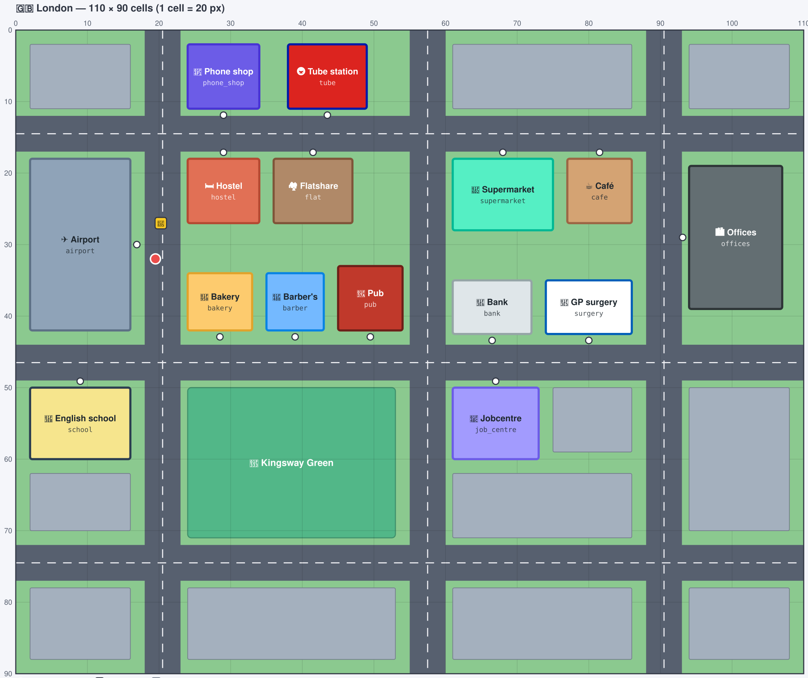

# Criar locais, missões e cidades

[English](creating-a-city.md) · **Português**

Tudo o que vês no jogo — ruas, lojas, personagens, preços, missões — está escrito em ficheiros de texto,
não em código. Uma cidade é uma pasta em [`packs/`](../packs/) com seis ficheiros YAML. Se sabes editar um
ficheiro de texto, consegues acrescentar uma farmácia, escrever uma missão sobre ligar ao senhorio ou
construir uma cidade inteira.

Este guia é a parte prática. Todos os campos e regras estão na
[especificação dos city packs](city-pack-spec.md) (em inglês).

- [Antes de começar](#antes-de-começar)
- [Acrescentar um local em dez minutos](#acrescentar-um-local-em-dez-minutos)
- [Acrescentar uma missão](#acrescentar-uma-missão)
- [Desenhar o mapa](#desenhar-o-mapa)
- [Criar uma cidade nova](#criar-uma-cidade-nova)
- [Aulas e a escola](#aulas-e-a-escola)
- [Quando o verificador se queixa](#quando-o-verificador-se-queixa)
- [Escrever boas personagens e missões](#escrever-boas-personagens-e-missões)
- [Antes de abrir um pull request](#antes-de-abrir-um-pull-request)

## Antes de começar

```bash
npm install
npm run pack      # verifica todas as cidades em packs/ e diz o que está mal
npm start         # constrói e corre o jogo em http://localhost:8787
```

Não precisas de chave de IA: sem ela o jogo corre em modo offline, em que as personagens respondem com
regras simples. Chega para confirmar que o teu local abre, vende e cobra correctamente.

Uma pasta de cidade tem estes ficheiros:

| Ficheiro | O que tem |
|---|---|
| `city.yaml` | nome, país, língua, moeda, dinheiro inicial, ordem da história, missões diárias, empregos |
| `map.yaml` | tamanho do mapa, estradas, o parque, edifícios onde não se entra, onde o jogador aterra |
| `places.yaml` | todos os locais onde se pode entrar: o edifício, quem lá trabalha, o que vende |
| `people.yaml` | pessoas a andar na rua, para conversa de circunstância |
| `actions.yaml` | o que as personagens podem fazer (vender, alugar, contratar…) e os limites |
| `missions.yaml` | missões de história, de emprego e diárias |

O jogo traz duas cidades. Lê-as lado a lado para ver o que muda de uma cidade para outra:
[`packs/maple-city/`](../packs/maple-city/) (inglês americano, dólares) e [`packs/london/`](../packs/london/)
(inglês britânico, libras, um passo extra na história).

> Os nomes dos campos e os textos que a IA lê (`persona`, `brief`) escrevem-se em inglês. Os textos que o
> jogador lê (`title`, `goal`) têm uma versão por língua da interface.

## Acrescentar um local em dez minutos

Vamos acrescentar uma farmácia à Maple City.

**1. Encontra um sítio livre.** O mapa é uma grelha de células; as posições são `[coluna, linha]` a contar
do canto superior esquerdo. Um edifício não pode ficar em cima de uma estrada nem de outro edifício, e a
porta tem de estar livre e a 2 células ou menos de uma estrada. Em
[`packs/maple-city/map.yaml`](../packs/maple-city/map.yaml) as estradas têm 5 células de largura, nas
linhas 15, 45, 75 e nas colunas 15, 50, 85; cada quarteirão é o espaço entre elas. Há lugar ao lado da
barbearia, na coluna 43, linha 35.

**2. Acrescenta o local** no fim de `packs/maple-city/places.yaml`:

```yaml
pharmacy:                                  # o id: minúsculas, sem espaços, único na cidade
  name: "Greenleaf Pharmacy"
  short: "Pharmacy"                        # etiqueta no mapa
  icon: 💊
  building: { at: [43, 35], size: [6, 8], door: bottom, color: "#81ecec", roof: "#00a8a8" }
  character:
    id: pharmacist
    name: "Nora"
    emoji: 💊
    voice: { gender: female, rate: 1 }
    role: "Pharmacist at Greenleaf Pharmacy"
    persona: >
      Nora Kim, 36, careful and friendly pharmacist. Always asks who the medicine is for,
      what the symptoms are and about allergies before recommending anything.
  sells:
    painkillers: { price: 6.50 }
    cough syrup: { price: 8.99, health: 10, consume: now }
    plasters:    { price: 3.25 }
    vitamin C:   { price: 9.50 }
  vocabulary: ["painkillers", "cough", "over the counter", "twice a day", "side effects", "allergic to"]
```

- `door` é o lado do edifício onde fica a porta (`top`, `bottom`, `left`, `right`). Aponta-a para uma rua.
- `persona` é o que a IA lê para fazer de personagem: idade, feitio, maneira de falar, o que pergunta sempre.
- `voice` é como a personagem soa: `gender`, `rate` (1 = velocidade normal) e, se quiseres uma
  [voz Deepgram](https://developers.deepgram.com/docs/tts-models) em particular, `deepgram: aura-2-draco-en`. Sem isso, o
  jogo escolhe uma voz com o sotaque da cidade.
- `sells` é a tabela de preços. A IA só pode vender o que está aqui, mais ou menos a este preço (±30%).
  `food`, `energy` e `health` são o que o artigo dá ao jogador; `consume: now` quer dizer que é consumido
  na hora em vez de ir para o inventário.
- `vocabulary` aparece ao jogador como dicas; usar uma destas expressões numa frase dá XP.

**3. Verifica.**

```bash
npm run pack -- maple-city
```

`✓ maple-city: 14 places…` quer dizer que está válido. Caso contrário recebes uma frase que diz o
ficheiro, a entrada e o que corrigir.

**4. Joga.** Corre `npm start`, voa para a Maple City e entra. Sem missão nesse local, o jogador tem a
conversa geral de "visita": a personagem atende-o e pode vender o que está na tabela.

## Acrescentar uma missão

Uma missão é uma situação num local: o que o jogador tem de fazer, o que a personagem sabe e quando conta
como concluída. Acrescenta isto no fim de `packs/maple-city/missions.yaml`:

```yaml
sore_throat:
  kind: daily                              # story, daily, job, social ou free
  at: pharmacy                             # onde acontece (o id de um local)
  title: { en: Something for a sore throat, pt: Algo para a dor de garganta }
  goal:                                    # o que o jogador lê
    en: Explain your symptoms at {{place.name}} and buy cough syrup.
    pt: Explica os teus sintomas na {{place.name}} e compra xarope para a tosse.
  brief: >                                 # o que a IA lê; o jogador nunca vê isto
    The customer has had a sore throat and a cough for two days. Do not guess: ask about the
    symptoms, how long, and allergies. Recommend the cough syrup and explain how to take it
    (twice a day, after meals). {{price_list}}
  allow: [sell, end]                       # o que a personagem pode fazer (actions.yaml)
  complete: { did: sell, item: [cough syrup] }
  reward: { xp: 50, social: 4 }
```

Depois diz à cidade quando a missão aparece. Para uma missão diária, junta-a ao sorteio em `city.yaml`:

```yaml
daily:
  count: 3
  pool:
    - { mission: sore_throat }
```

Para uma missão de história, usa `kind: story` e põe o id na lista `story:` de `city.yaml`, na posição em
que deve acontecer.

Convém saber:

- **`{{…}}` insere um valor**, para os textos nunca ficarem desactualizados: `{{place.name}}`,
  `{{money place.hotel.lodging.price}}`, `{{city.name}}`, `{{price_list}}` (a tabela de preços do local,
  para a IA). Um nome que não existe é apanhado pelo verificador.
- **`complete`** decide quando a missão está feita. Os mais comuns: `{ did: sell }` (a personagem fez essa
  acção), `{ flag: phone }` (alguma coisa activou essa flag), `{ bought: with.items }` (uma lista de
  compras), `{ turns: 4 }` (o jogador enviou quatro mensagens).
- **`requires`** mantém a missão fechada até o jogador estar pronto: `{ has: home }`, `{ flag: bank }`,
  `{ level: A2 }`.
- **A IA só pede; o jogo decide.** Uma personagem só pode fazer as acções que estão em `allow`, e cada
  acção tem limites em `actions.yaml`. Uma personagem não pode oferecer dinheiro, por muito que o jogador
  peça com jeitinho.

### Flags: coisas que o jogador tem

Um artigo ou uma acção pode activar uma flag, e as missões podem esperar por ela. É assim que Londres
acrescenta um passo à história sem código nenhum — em `places.yaml`:

```yaml
    Oyster card: { price: 7.00, effects: [{ set_flag: oyster }] }
```

e em `missions.yaml`:

```yaml
get_oyster:
  kind: story
  at: tube
  ...
  complete: { flag: oyster }
```

## Desenhar o mapa

Um mapa é uma folha de papel quadriculado. Cada quadrado é uma **célula** (20 píxeis no jogo) e cada posição
escreve-se `[coluna, linha]`, a contar do canto superior esquerdo: `[0, 0]` é a célula de cima à esquerda,
as colunas crescem para a direita e as linhas para baixo. Isto é Londres, tal como o `npm run pack` a desenha:



Os números em cima e à esquerda são os que escreves nos ficheiros. O Jobcentre da imagem começa na coluna
61, linha 50, e tem 12 células de largura e 10 de altura; em `places.yaml` isso é
`building: { at: [61, 50], size: [12, 10], door: top }`.

Tudo o que diz respeito ao chão está em `map.yaml`:

```yaml
cell: 20
size: [110, 90]              # colunas, linhas

roads:                       # cada estrada atravessa o mapa todo
  - { row: 12, width: 5 }    # estrada horizontal que ocupa as linhas 12 a 16
  - { col: 18, width: 5 }    # estrada vertical que ocupa as colunas 18 a 22

park: { name: Kingsway Green, at: [24, 50], size: [29, 21] }

decor:                       # edifícios onde ninguém entra; só enchem a cidade
  - { at: [2, 2], size: [14, 9] }

spawn: [19.5, 32]            # onde o jogador está quando o jogo começa
taxi_stand: [20.25, 27]      # onde o táxi deixa e apanha
```

Os edifícios onde se pode entrar não estão aqui: cada um é a linha `building:` do seu local em `places.yaml`.

**Como fazer**

1. **Primeiro as estradas.** Cortam o mapa em quarteirões. Três na horizontal e três na vertical, com 5
   células de largura, é um bom começo.
2. **Aponta os quarteirões.** Com estradas nas colunas 18–22 e 55–59, o quarteirão entre elas vai da coluna
   23 à 54. Um edifício tem de caber dentro de um quarteirão.
3. **Coloca os edifícios** onde se entra, cada um com a porta do lado de uma rua.
4. **Enche o resto** com o parque e decoração, para a cidade não parecer vazia.
5. **Põe o jogador** (`spawn`) na estrada em frente ao local onde a história começa.
6. **Corre `npm run pack -- my-city` e abre `packs/my-city/preview.svg`** no browser. Muda um número, corre
   outra vez, olha outra vez. Demora um segundo, e nunca precisas de abrir o jogo para ver o mapa.

**As regras que o verificador impõe**

| Regra | Porquê |
|---|---|
| Edifícios, parque e decoração ficam dentro do mapa e não se sobrepõem entre si nem a uma estrada | ficariam desenhados uns por cima dos outros |
| Uma porta está a 2 células ou menos de uma estrada e não tem nada à frente | os jogadores procuram as portas a partir da rua |
| O jogador consegue ir a pé do `spawn` a todas as portas, ao parque e à praça de táxis | um local onde ninguém chega é uma missão que ninguém termina |
| Uma passagem tem de ser mais larga do que o jogador (um pouco mais de uma célula) | passagens mais estreitas parecem abertas, mas não são |
| `spawn` e `taxi_stand` não ficam dentro de um edifício | o jogador começaria preso |

**Vê-o em 3D.** Abre **http://localhost:8787/viewer.html?city=my-city** (ou 🗺️ no ecrã inicial do jogo).
Mostra a mesma cidade de três maneiras: a imagem do mapa, uma cidade 3D que podes rodar, e a andar pelas
ruas em primeira pessoa. O servidor lê as cidades quando arranca, por isso reinicia-o depois de uma
alteração. A altura de um edifício vem do tamanho; para a escolheres, acrescenta `floors` ao `building:`
(ou a uma entrada de `decor`): `building: { at: [94, 19], size: [13, 20], door: left, floors: 9 }`.

**Tamanhos que resultam:** uma loja pequena tem cerca de 8 × 8 células, um supermercado 14 × 10, um
aeroporto 14 × 24. Abaixo de 5 × 5 o nome não cabe no edifício (o verificador avisa). Um mapa de cerca de
110 × 90 células atravessa-se a pé em dois minutos, o que está certo para uma cidade com uma dúzia de locais.


## Criar uma cidade nova

**1. Copia uma cidade e muda-lhe o nome.**

```bash
cp -r packs/london packs/my-city
```

Em `packs/my-city/city.yaml` muda o `id` (tem de ser o nome da pasta), `name`, `country`, `flag`,
`language` (por exemplo `en-AU`; define o sotaque das vozes) e `currency`.

**2. Desenha o mapa** em `map.yaml`, seguindo [Desenhar o mapa](#desenhar-o-mapa) acima: primeiro as estradas,
depois os edifícios nos quarteirões, sempre a olhar para a imagem.

**3. Escreve os locais** em `places.yaml`. Uma cidade precisa pelo menos de: onde o jogador chega, um sítio
para morar (um local com bloco `lodging`) e os locais para onde a história e os empregos apontam.

**4. Escreve as pessoas** em `people.yaml`: nome, emoji, cor e persona. Quatro chegam; com oito a rua
ganha vida.

**5. Adapta as acções** em `actions.yaml`. A cópia já tem tudo o que uma cidade precisa. Muda os preços do
táxi (`agree_price`), os nomes em `set_destination` e os textos.

**6. Escreve as missões** em `missions.yaml` e ordena a história em `city.yaml`. Os ids das missões és tu
que escolhes. Mantém uma missão com `with_person: true` (falar com pessoas na rua) e uma com `at: any`
(entrar num local sem missão).

**7. Define os empregos** em `city.yaml`: para cada profissão que o jogador pode escolher, onde trabalha na
tua cidade, o cargo e o pagamento por turno. A lista de profissões é do jogo; `other` tem de lá estar.

**8. Verifica e joga.**

```bash
npm run pack -- my-city
npm start
```

A tua cidade aparece no painel de partidas como voo aberto. Reinicia o servidor depois de mudares um
pack: as cidades são lidas no arranque.

## Aulas e a escola

Todas as cidades têm uma escola de inglês: um local com `school: true` em `places.yaml`, cuja personagem
é o professor. Ao entrar abre-se a sala de aula — um quadro e o professor — onde o jogador faz as aulas do
curso, ouve cada frase, repete-a ao microfone, faz alguns exercícios e guarda as frases no caderno. O
verificador recusa uma cidade sem escola.

```yaml
school:
  name: "Kingsway English School"
  short: "English school"
  icon: 🏫
  school: true
  building: { at: [2, 50], size: [14, 10], door: top, color: "#f6e58d", roof: "#2c3e50", floors: 3 }
  character:
    id: teacher
    name: "Mr. Grant"
    emoji: 👨‍🏫
    voice: { gender: male, rate: 0.9 }
    role: "English teacher at Kingsway English School"
    persona: >
      Oliver Grant, 46, patient and cheerful English teacher. Speaks slowly and clearly.
```

As aulas são as mesmas em todas as cidades e ficam em [`courses/english/`](../courses/english/), um
ficheiro por nível (`a1.yaml`, `a2.yaml`…), pela ordem em que se ensinam:

```yaml
- id: a1-taxi
  title: { en: Taking a taxi, pt: Apanhar um táxi }
  goal: { en: Say where you are going and agree the fare., pt: Dizer para onde vais e combinar o preço da corrida. }
  phrases:
    - { en: "How much is it to …?", pt: "Quanto custa até …?" }
    - { en: "That's too expensive.", "en-GB": "That's a bit steep.", pt: "Isso é muito caro." }
  tip: { en: …, pt: … }
  exercises:
    - { type: gap, text: "How ___ is it to the hotel?", options: [much, many, cost], answer: much }
    - { type: order, answer: "Can you take me to the station" }
    - type: choose
      prompt: { en: "The driver asks for 75. You say:", pt: "O taxista pede 75. Dizes:" }
      options: ["That's too expensive. Can you do it for fifty?", "Keep the change."]
      answer: "That's too expensive. Can you do it for fifty?"
```

- `en-GB` / `en-US` dão a frase como se diz nesse inglês; Londres mostra "That's a bit steep".
- Uma missão diz que aula a prepara com `lesson: a1-taxi` em `missions.yaml`. O telemóvel lembra o
  jogador de fazer essa aula antes da missão, e o GPS pode levá-lo à escola.
- O servidor verifica o curso ao arrancar e explica qualquer erro (uma tradução em falta, uma resposta
  que não está nas opções…); o `npm test` também o verifica.


## Quando o verificador se queixa

As mensagens dizem o ficheiro, a entrada e o problema. Algumas reais:

```
places.yaml › barber › character: missing "role" (their job, in a few words)
places.yaml › barber › building: "barber" overlaps the road at row 45. Move it off the road
places.yaml › phone_store › building: nobody can walk from where the player lands to the door of "phone_store": other buildings close the way. Leave a passage, or move the door to another side
city.yaml › jobs › chef: workplace "restaurant" is not a place. Known: airport, phone_store, hotel, …
missions.yaml › get_phone › goal › en: {{place.nam}} does not exist for place "phone_store"
missions.yaml › barber_cut › allow: unknown action "shave". Known: agree_price, set_destination, rent, …
missions.yaml › barber_cut › complete: waits for "service", which is not in "allow" — the mission could never be finished
```

Uma mensagem como `All mapping items must start at the same column at line 291` quer dizer que o próprio
YAML está partido, quase sempre a indentação: usa espaços (nunca tabs) e alinha os campos uns por baixo
dos outros. Textos com `:` ou que começam por `{{` precisam de aspas:
`title: { en: "Shopping: {{list with.items}}" }`.

As linhas que começam por `⚠` são conselhos, não erros: a cidade funciona, mas alguma coisa vai
provavelmente desiludir os jogadores (uma missão sem texto em português, uma loja sem vocabulário, dinheiro
inicial que não chega para a primeira noite). Nunca fazem a verificação falhar; corrige os que fizerem sentido.

```
  ⚠ missions.yaml › get_phone › title: no "pt" text; players using that language will read the English one
  ⚠ places.yaml › bakery: sells things but has no "vocabulary"; players get no hints here
```

Uma cidade com erros fica de fora quando o jogo arranca (o motivo aparece no log do servidor); as outras
continuam a funcionar.

## Escrever boas personagens e missões

- **Dá voz às personagens.** De onde são, o feitio, duas ou três expressões que usam, o que perguntam
  sempre. "Trata os clientes por *love*, orgulhosa dos seus sausage rolls, pergunta *eat in or take away?*"
  resulta muito melhor do que "uma padeira simpática".
- **Ensina a língua local.** Um pack de Londres diz *queue*, *till*, *flat*, *cheers*; um americano diz
  *line*, *checkout*, *apartment*. Põe essas palavras em `vocabulary`.
- **Obriga o jogador a falar.** No `brief`, diz à personagem o que o cliente precisa, mas acrescenta "they
  must ask for it themselves" — senão a IA, prestável, diz tudo por ele.
- **Uma situação por missão**, algo que um recém-chegado enfrenta mesmo: inscrever-se no médico, devolver
  um telemóvel avariado, pedir ao vizinho para fazer menos barulho.
- **Usa preços realistas** para a cidade e a moeda. O jogador começa com pouco dinheiro, e gerir o
  orçamento faz parte do jogo.
- **Inventa os nomes.** Lojas e pessoas inventadas, não marcas nem pessoas reais.
- **Escreve `title` e `goal` em todas as línguas da interface** que conseguires. `en` é obrigatório; uma
  língua que falte (`pt`) usa o inglês.

## Antes de abrir um pull request

- [ ] `npm run pack` mostra um ✓ na tua cidade, e fizeste commit do `preview.svg` que ele escreveu (a imagem do mapa).
- [ ] `npm test` passa (`make check` corre os dois).
- [ ] Jogaste: o local abre, a missão pode ser concluída, os preços cobrados são os que escreveste.
- [ ] Os nomes de locais e pessoas são inventados.
- [ ] O pull request diz o que acrescentaste e, para o que é visível, inclui uma captura de ecrã.

Cada pull request é verificado automaticamente no GitHub: os testes, todos os city packs, se as imagens dos
mapas estão actualizadas e se o jogo compila. Um ✗ vermelho lá diz-te qual destes deves ver.

Ficaste preso, ou falta alguma coisa que o formato ainda não consegue exprimir?
[Abre uma issue](https://github.com/Hudson512/Open-Course-ENGLISH-CITY/issues) — em inglês, português ou francês.
